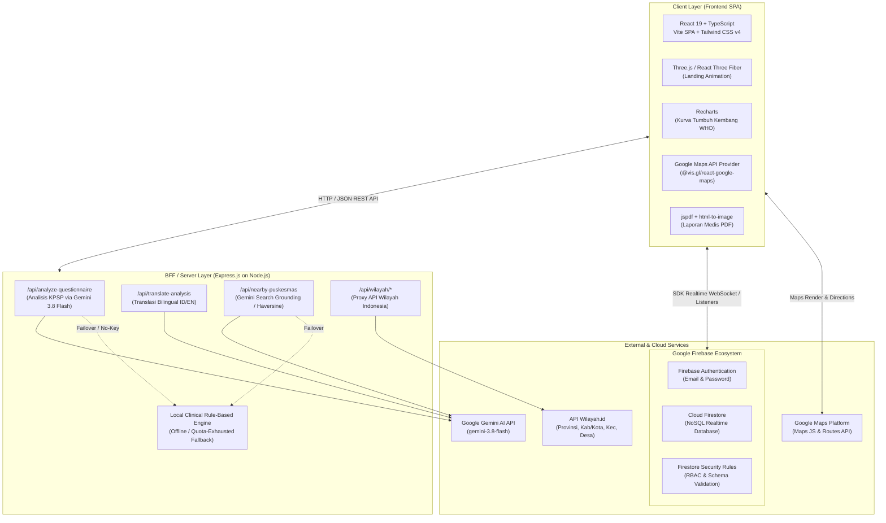

# Overview Aplikasi: GrowthSync (KINDO - Kuesioner Tumbuh Kembang Anak)

> **Catatan Dokumen**: Dokumen ini disusun sebagai ringkasan arsitektur sistem, aliran kerja (*flow*), dan model data dari platform GrowthSync (KINDO). **File ini tidak untuk di-commit ke repositori Git.**

---

## 1. Ringkasan Eksekutif (Executive Summary)

**GrowthSync (KINDO)** adalah platform kesehatan digital komprehensif yang dirancang untuk mendigitalisasi instrumen **KPSP (Kuesioner Pra Skrining Perkembangan)** dari Kementerian Kesehatan Republik Indonesia (Kemenkes RI) dan **Buku KIA (Kesehatan Ibu dan Anak)**. 

Platform ini memungkinkan orang tua memantau tumbuh kembang dan parameter antropometri anak secara mandiri dari rumah (usia 3 hingga 72 bulan), memperoleh interpretasi klinis terarah melalui integrasi **Google Gemini AI**, berkonsultasi langsung dengan **Tenaga Kesehatan (Bidan/Dokter Anak)** secara *real-time*, serta menemukan fasilitas kesehatan (**Puskesmas**) terdekat dengan navigasi rute berbasis **Google Maps Platform**.

### Masalah yang Diselesaikan
1. **Kompleksitas Buku Manual KIA**: Orang tua sering kesulitan membaca panduan tumbuh kembang manual dan melewatkan periode emas (*golden age*) deteksi dini penyimpangan perkembangan atau risiko stunting.
2. **Keterbatasan Akses Faskes**: Skrining berkala di Posyandu/Puskesmas sering terkendala jarak, waktu, atau antrean.
3. **Ketiadaan Tindak Lanjut Terpadu**: Skrining mandiri seringkali berakhir tanpa panduan stimulasi yang spesifik atau rujukan langsung ke tenaga medis berkompeten.

---

## 2. Arsitektur Sistem (System Architecture)

Aplikasi ini menggunakan pola arsitektur **Hybrid Client-Server / Backend-for-Frontend (BFF)** yang didukung oleh **Firebase BaaS (Backend-as-a-Service)** untuk persistensi data *real-time*, serta server **Express.js** untuk orkestrasi kecerdasan buatan (Google GenAI) dan proxy API pihak ketiga.

### 2.1 Diagram Arsitektur Tingkat Tinggi

---

## 3. Peran Pengguna & Kontrol Akses (User Roles & RBAC)

Sistem mengimplementasikan **Role-Based Access Control (RBAC)** dengan 3 jenis peran pengguna:

1. **Orang Tua (`orang_tua`)**:
   - Mendaftarkan profil balita dan parameter antropometri awal.
   - Melakukan skrining mandiri KPSP sesuai usia kronologis anak.
   - Memperoleh analisis klinis instan dari Gemini AI beserta panduan stimulasi.
   - Mencatat dan memantau riwayat pertumbuhan (BB, TB, LK) per bulan.
   - Melakukan telekonsultasi langsung dengan Nakes terhubung.
   - Menemukan Puskesmas terdekat dengan panduan navigasi rute di peta.
   - Mengunduh laporan riwayat perkembangan format PDF.

2. **Tenaga Kesehatan (`nakes`)**:
   - Mendaftar dengan menyertakan Nomor SIP (Surat Izin Praktik).
   - Menunggu persetujuan dan verifikasi dari Administrator.
   - Mengelola daftar pasien (Pasien Saya & Pasien Belum Ditugaskan).
   - Mengklaim orang tua pasien untuk pendampingan berkala.
   - Menginspeksi rekam medis dan grafik tumbuh kembang anak secara mendalam.
   - Berinteraksi dengan orang tua melalui ruang obrolan *real-time*.

3. **Administrator (`admin`)**:
   - Memantau dasbor analitik dan statistik operasional platform.
   - Memvalidasi dan menyetujui/menolak permohonan akun Tenaga Kesehatan berdasarkan SIP.
   - Mendaftarkan akun Nakes baru secara langsung dengan data wilayah bertingkat.
   - Mengaudit log aktivitas penting di dalam sistem (`adminLogs`).

---

## 4. Alur Kerja Utama Aplikasi (Core Workflows)

### 4.1 Alur Skrining KPSP (Kuesioner Pra Skrining Perkembangan)
- Instrumen KPSP mencakup **16 kategori usia** (3, 6, 9, 12, 15, 18, 21, 24, 30, 36, 42, 48, 54, 60, 66, dan 72 bulan).
- Setiap kategori usia menyajikan **10 pertanyaan terstandar** dengan petunjuk alat yang perlu disiapkan (misal: benang wol merah, kubus kayu, pensil, kertas) dan ilustrasi gambar jika diperlukan.
- **Kategori Skor**:
  - Skor **9 - 10**: **Sesuai (Perkembangan Normal)**.
  - Skor **7 - 8**: **Meragukan (Butuh Stimulasi Tambahan)** selama 2-4 minggu ke depan.
  - Skor **< 7**: **Penyimpangan (Butuh Konsultasi / Rujukan Ahli)** ke faskes/dokter spesialis anak.

### 4.2 Alur Analisis AI & Mekanisme Failover (Resilience System)
- Jawaban KPSP dikirim ke endpoint `/api/analyze-questionnaire`.
- Server menyuntikkan basis pengetahuan klinis resmi Kemenkes (`INTERVENSI_KNOWLEDGE`) ke dalam prompt kontekstual model **Gemini 3.8 Flash**.
- **Failover Engine**: Jika API key Gemini belum dikonfigurasi atau kuota API habis (Error 429), server secara transparan mengeksekusi *Rule-Based Clinical Fallback Engine* lokal (`getFallbackAnalysis`) sehingga pengguna tetap memperoleh hasil analisis berkualitas tanpa gangguan.

### 4.3 Alur Telekonsultasi & Pemetaan Faskes
- **Pesan Realtime**: Menggunakan Firestore `messages` collection dengan *realtime listener* (`onSnapshot`), badge unread count, dan indikasi status baca.
- **Puskesmas Finder**: Memanfaatkan geolokasi HTML5 pengguna, mencari Puskesmas dalam radius terdekat via Google Search Grounding atau Haversine formula, serta memvisualisasikan rute mengemudi menggunakan Google Maps Routes API.

---

## 5. Model Data & Skema Firestore (Database Schema)

1. **`users`**: UID, email, role (`orang_tua` | `nakes` | `admin`), nama, wilayah (provinsi, kabupaten, kecamatan, kelurahan), `assignedNakesId`, `sip`, `isVerified`.
2. **`childProfiles`**: ID, `userId`, nama, `birthDate`, `ageInMonths`, `heightCm`, `weightKg`, `headCircumferenceCm`, `gender`, `growthHistory` array, `updatedAt`.
3. **`questionnaireResults`**: ID, `userId`, `profileId`, `ageCategory`, `answers` map, `totalScore`, `aiAnalysis` (ID & EN), `createdAt`.
4. **`messages`**: `senderId`, `receiverId`, `text`, `timestamp`, `read`, `createdAt`.
5. **`adminLogs`**: `adminUid`, `action`, `targetUid`, `details`, `createdAt`.

