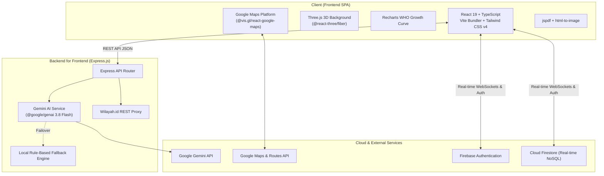
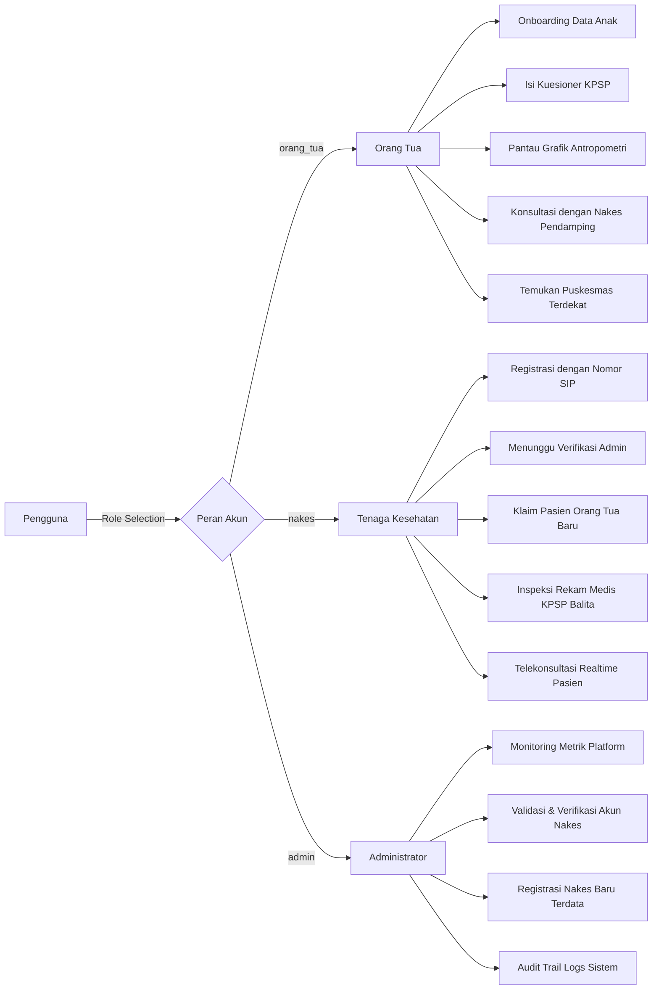
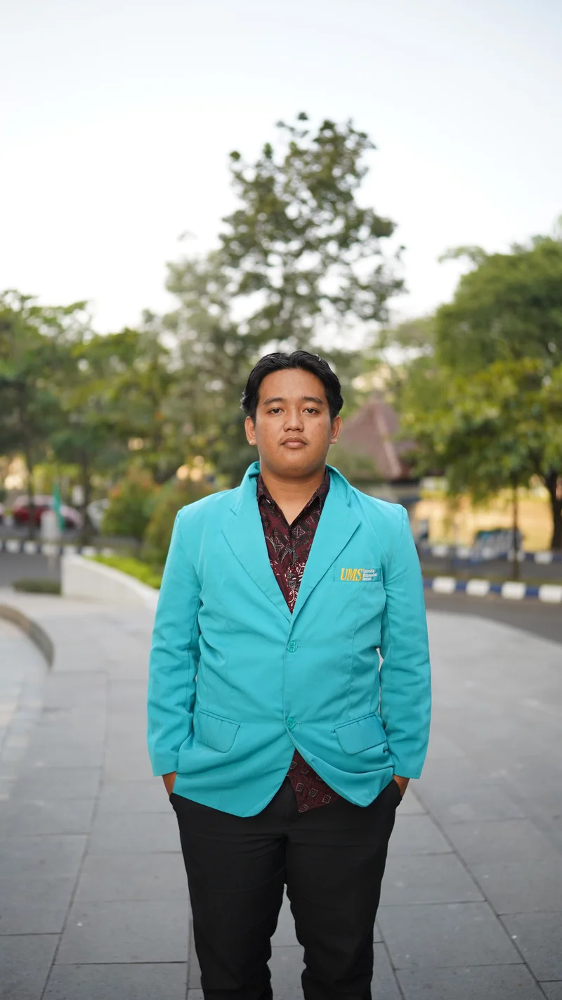

<div align="center">

  

# 🌟 KINDO

### _Digital Child Growth & Development Screening Platform powered by Gemini AI_

**Platform Deteksi Dini Tumbuh Kembang Balita & Pencegahan Stunting Berbasis Instrumen KPSP Kemenkes RI**

  <p align="center">
    <a href="#-tentang-aplikasi">Tentang</a> •
    <a href="#-fitur-unggulan">Fitur Utama</a> •
    <a href="#-arsitektur-sistem">Arsitektur</a> •
    <a href="#-peran-pengguna-rbac">Peran Pengguna</a> •
    <a href="#-tech-stack">Tech Stack</a> •
    <a href="#-panduan-instalasi">Instalasi</a> •
    <a href="#-tim-pengembang">Tim Pengembang</a>
  </p>

  <p align="center">
    
    
    
    
    
    
    
    
  </p>

</div>

---

## 📖 Tentang Aplikasi

**KINDO** adalah aplikasi kesehatan digital inovatif yang dikembangkan oleh mahasiswa **Universitas Muhammadiyah Surakarta (UMS)** untuk mentransformasi pemantauan kesehatan balita di Indonesia.

Melalui digitalisasi **Buku KIA (Kesehatan Ibu dan Anak)** dan instrumen resmi **KPSP (Kuesioner Pra Skrining Perkembangan) Kementerian Kesehatan RI**, platform ini memampukan orang tua mendeteksi secara mandiri potensi keterlambatan perkembangan anak sejak dini (usia 3 hingga 72 bulan), mengamati pertumbuhan antropometri terhadap standar **WHO**, berkonsultasi secara interaktif dengan **Tenaga Kesehatan (Nakes)** terverifikasi, dan menemukan fasilitas **Puskesmas** terdekat secara terintegrasi.

### 🎯 Masalah yang Diselesaikan

- **Buku KIA Manual yang Rumit**: Orang tua sering kesulitan menginterpretasi panduan manual dan melewatkan _golden age_ deteksi dini stunting atau autisme/keterlambatan gerak.
- **Keterbatasan Frekuensi Posyandu**: Kunjungan ke Posyandu yang hanya sebulan sekali seringkali membutuhkan suplemen pemantauan mandiri di rumah.
- **Ketiadaan Rujukan Terarah**: Skrining mandiri seringkali tidak diikuti panduan stimulasi yang teruji secara medis atau saluran komunikasi ke tenaga kesehatan profesional.

---

## ✨ Fitur Unggulan

<table>
  <tr>
    <td width="50%">
      <h3>📋 Skrining KPSP Terstandar Kemenkes RI</h3>
      <ul>
        <li><b>16 Kelompok Usia</b>: Mencakup skrining dari usia 3, 6, 9, 12, 15, 18, 21, 24, 30, 36, 42, 48, 54, 60, 66, hingga 72 bulan.</li>
        <li><b>4 Domain Perkembangan</b>: Gerak Kasar, Gerak Halus, Bicara & Bahasa, serta Sosialisasi & Kemandirian.</li>
        <li><b>Panduan Visual & Alat</b>: Dilengkapi daftar peralatan yang perlu disiapkan (misal: benang wol merah, kubus kayu) dan gambar ilustrasi pertanyaan.</li>
      </ul>
    </td>
    <td width="50%">
      <h3>🤖 Analisis Cerdas Google Gemini AI</h3>
      <ul>
        <li><b>Model Gemini 3.8 Flash</b>: Menghasilkan interpretasi hasil skrining (Sesuai, Meragukan, atau Penyimpangan) dengan bahasa suportif dan ramah orang tua.</li>
        <li><b>Grounded Clinical Interventions</b>: Didasarkan langsung pada kurikulum intervensi medis Kemenkes RI.</li>
        <li><b>Dual-Layer Resilience Fallback</b>: Otomatis beralih ke <i>Rule-Based Clinical Engine</i> lokal saat kuota API atau koneksi eksternal terganggu (Zero Downtime).</li>
      </ul>
    </td>
  </tr>
  <tr>
    <td width="50%">
      <h3>📈 Kurva Pertumbuhan Antropometri WHO</h3>
      <ul>
        <li>Visualisasi interaktif grafik <b>Berat Badan (BB)</b>, <b>Tinggi Badan (TB)</b>, dan <b>Lingkar Kepala (LK)</b> menggunakan Recharts.</li>
        <li>Komparasi trajektori pertumbuhan riil terhadap standar persentil median WHO.</li>
        <li>Manajemen multi-profil anak dalam satu akun orang tua.</li>
      </ul>
    </td>
    <td width="50%">
      <h3>💬 Telekonsultasi Real-time Nakes & Ortu</h3>
      <ul>
        <li>Komunikasi <i>real-time messaging</i> berbasis Firebase Firestore dengan indikator status baca (*read receipt*) dan penghitung pesan belum dibaca.</li>
        <li>Pengelompokan nakes (Dokter Spesialis Anak, Bidan Desa, Ahli Gizi, Kader Posyandu).</li>
        <li>Sistem penugasan & klaim pasien terpadu oleh Nakes resmi.</li>
      </ul>
    </td>
  </tr>
  <tr>
    <td width="50%">
      <h3>🗺️ Puskesmas Finder & Geonavigasi</h3>
      <ul>
        <li>Pencarian Puskesmas terdekat berbasis koordinat GPS pengguna menggunakan Google Maps API dan Gemini Search Grounding.</li>
        <li>Perhitungan rute berkendara langsung di peta via Google Maps Routes API.</li>
        <li>Informasi kontak telepon dan alamat faskes lengkap.</li>
      </ul>
    </td>
    <td width="50%">
      <h3>📄 Laporan Medis PDF Siap Cetak</h3>
      <ul>
        <li>Ekspor resume hasil skrining dan grafik antropometri ke dokumen format PDF berstandar klinis dalam satu klik via <code>jspdf</code>.</li>
        <li>Dukungan dwibahasa (Bahasa Indonesia & Bahasa Inggris) via <code>i18next</code>.</li>
        <li>Tema Gelap (*Dark Mode*) dan Terang (*Light Mode*) yang nyaman di mata.</li>
      </ul>
    </td>
  </tr>
</table>

---

## 🏛️ Arsitektur Sistem

Aplikasi dibangun di atas pondasi **Backend-for-Frontend (BFF)** dengan sinkronisasi basis data waktu-nyata (_real-time BaaS_):



---

## 👥 Peran Pengguna (RBAC)

Aplikasi memiliki 3 hak akses dengan alur kerja spesifik:



---

## 💻 Tech Stack

| Komponen               | Teknologi                              | Keterangan                                                              |
| ---------------------- | -------------------------------------- | ----------------------------------------------------------------------- |
| **Frontend Framework** | **React 19**, **TypeScript**           | Komponen UI reaktif generasi terbaru dengan kepatuhan tipe ketat        |
| **Build Tool**         | **Vite 6**                             | _Lightning-fast_ Hot Module Replacement & optimasi aset _production_    |
| **Styling & Motion**   | **Tailwind CSS v4**, **Motion**        | Styling modern performa tinggi dengan transisi _spring animation_ luwes |
| **3D Rendering**       | **Three.js**, **React Three Fiber**    | Animasi background 3D interaktif pada Landing Page                      |
| **AI Engine**          | **@google/genai (Gemini 3.8 Flash)**   | Model AI cepat dan akurat untuk analisis data kuesioner medis           |
| **Backend & BFF**      | **Express.js**, **Node.js**, **tsx**   | Server REST API modular, proxy regional, dan orkestrasi AI              |
| **Database & Auth**    | **Firebase Auth**, **Cloud Firestore** | Autentikasi aman dan sinkronisasi chat/dokumen secara _real-time_       |
| **Maps & Lokasi**      | **@vis.gl/react-google-maps**          | Integrasi Maps JavaScript API & Google Routes API                       |
| **Visualisasi Data**   | **Recharts**                           | Rendering kurva tumbuh kembang antropometri responsif                   |
| **PDF Generation**     | **jspdf**, **html-to-image**           | Konversi DOM template laporan menjadi dokumen cetak PDF                 |
| **Internasionalisasi** | **i18next**, **react-i18next**         | Manajemen multi-bahasa terpadu (Indonesia / English)                    |

---

## 📂 Struktur Direktori

```text
growthsync/
├── public/                       # Aset publik statis (logo, foto tim pengembang)
│   ├── team/                     # Foto profil kontributor
│   └── Resmi_Logo_UMS_Color.png  # Logo resmi Universitas Muhammadiyah Surakarta
├── src/
│   ├── components/               # Modul dan Tampilan Antarmuka
│   │   ├── AdminDashboardView.tsx    # Dashboard admin (verifikasi nakes & metrik)
│   │   ├── AuthView.tsx              # Autentikasi (login & register bertingkat wilayah)
│   │   ├── ChildOnboardingView.tsx   # Form registrasi data awal balita
│   │   ├── DashboardView.tsx         # Dashboard orang tua, grafik tumbuh & riwayat KPSP
│   │   ├── KonsultasiNakesView.tsx   # Ruang obrolan telekonsultasi nakes-orang tua
│   │   ├── LandingView.tsx           # Halaman pembuka interaktif dengan kanvas 3D
│   │   ├── NakesDashboardView.tsx    # Dashboard tenaga medis & klaim pasien
│   │   ├── ParentChatList.tsx        # Direktori nakes untuk konsultasi
│   │   ├── PuskesmasMapModal.tsx     # Modal peta geolokasi Puskesmas & rute
│   │   └── ThreeBackground.tsx       # Visual latar belakang 3D Three.js
│   ├── contexts/
│   │   └── LanguageContext.tsx       # Context state bahasa bilingual (ID / EN)
│   ├── data/
│   │   ├── knowledge.ts              # Basis pengetahuan klinis intervensi Kemenkes RI
│   │   ├── questions.ts              # Bank soal KPSP resmi usia 3 - 72 bulan
│   │   └── translations_en.ts        # File translasi kamus Bahasa Inggris
│   ├── lib/
│   │   ├── firebase.ts               # Inisialisasi Firebase App, Auth, dan Firestore
│   │   └── utils.ts                  # Helper utilities styling (clsx & tailwind-merge)
│   ├── App.tsx                       # Root routing, layout sidebar, dan role handling
│   ├── types.ts                      # Definisi skema dan tipe TypeScript global
│   └── main.tsx                      # Entry point React
├── server.ts                     # BFF Express Server (Gemini AI, Routes, Wilayah Proxy)
├── firestore.rules               # Aturan keamanan database Cloud Firestore
├── firebase-applet-config.json   # Konfigurasi proyek Firebase
└── package.json                  # Dependensi proyek
```

---

## 🚀 Panduan Instalasi & Menjalankan Proyek

### 1. Prasyarat Sistem

- **Node.js** versi `v18.0.0` atau lebih tinggi
- Package manager: `npm` atau `pnpm`
- Akun **Google AI Studio** (untuk API Key Gemini)
- Akun **Google Cloud Platform** (untuk Google Maps Platform API Key)

### 2. Kloning Repositori

```bash
git clone https://github.com/username-anda/growthsync.git
cd growthsync
```

### 3. Instalasi Dependensi

```bash
npm install
```

### 4. Konfigurasi Environment Variables

Salin file `.env.example` menjadi `.env` di root direktori proyek:

```bash
cp .env.example .env
```

Lalu lengkapi nilai variabel berikut:

```env
# Google Gemini API Key (diperoleh dari https://aistudio.google.com)
GEMINI_API_KEY="AIzaSyYourGeminiApiKeyHere"

# Google Maps Platform Key (aktifkan Maps JS API dan Routes API di GCP Console)
GOOGLE_MAPS_PLATFORM_KEY="AIzaSyYourGoogleMapsKeyHere"

# Port server (opsional, default 3000)
PORT=3000
```

### 5. Jalankan Aplikasi

```bash
# Mode Pengembangan (Hot Reload dengan Vite & tsx)
npm run dev
```

Buka browser Anda dan akses aplikasi di:

```text
http://localhost:3000
```

### 6. Build untuk Produksi

```bash
# Menghasilkan bundle static frontend & bundle server
npm run build

# Menjalankan server hasil build produksi
npm start
```

---

## 👨‍💻 Tim Pengembang (Contributors)

Platform ini dirancang dan dikembangkan dengan dedikasi tinggi oleh mahasiswa **Universitas Muhammadiyah Surakarta (UMS)**:

<div align="center">
  <table>
    <tr>
      <td align="center" width="20%">
        <br />
        <sub><b>Asrofi Noor Masithoh</b></sub><br />
        <sub>Developer</sub>
      </td>
      <td align="center" width="20%">
        <br />
        <sub><b>Putri Azzahra Namora</b></sub><br />
        <sub>Developer</sub>
      </td>
      <td align="center" width="20%">
        <br />
        <sub><b>Reja Arrafi</b></sub><br />
        <sub>Developer</sub>
      </td>
      <td align="center" width="20%">
        <br />
        <sub><b>Airlangga Pradana Prakusa</b></sub><br />
        <sub>Developer</sub>
      </td>
      <td align="center" width="20%">
        <br />
        <sub><b>Shafwan Aulia Rahman</b></sub><br />
        <sub>Developer</sub>
      </td>
    </tr>
  </table>
</div>

---

## 📜 Lisensi & Penghargaan

- **Lisensi**: Proyek ini dilindungi di bawah lisensi [MIT License](LICENSE).
- **Ucapan Terima Kasih**:
  - **Kementerian Kesehatan Republik Indonesia (Kemenkes RI)** atas standarisasi instrumen skrining KPSP dan Buku KIA.
  - **Universitas Muhammadiyah Surakarta (UMS)** atas dukungan akademis dan fasilitas riset inovasi.
  - **Google AI for Developers** atas dukungan teknologi model Google Gemini 3.8 Flash.

<div align="center">
  <br />
  <sub>Dibuat dengan ❤️ demi masa depan anak-anak Indonesia yang lebih cerdas dan bebas stunting.</sub><br />
  
</div>
